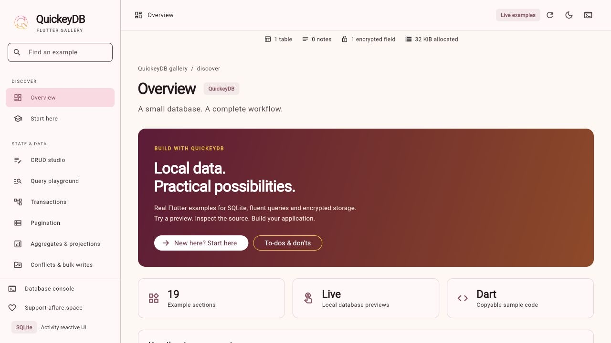
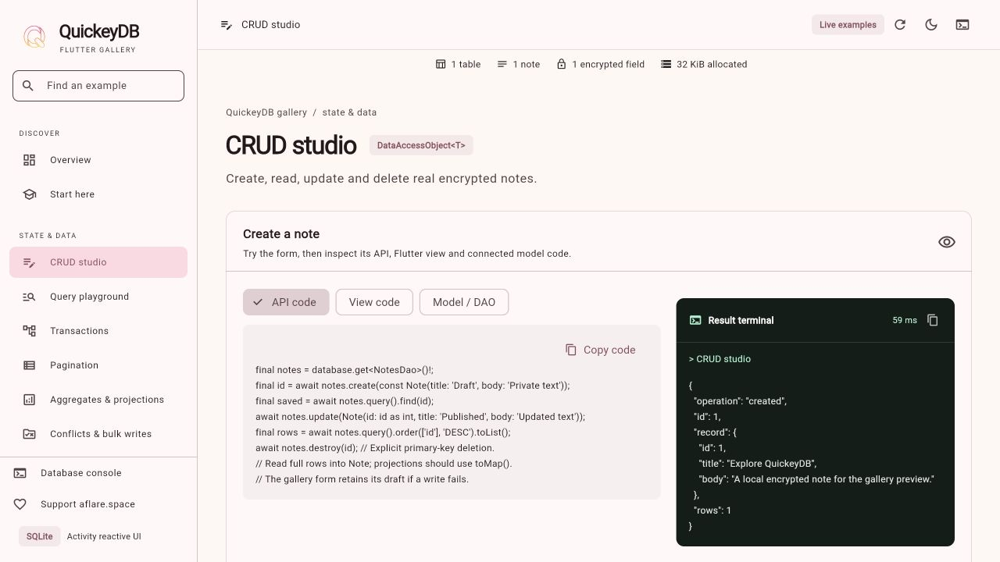
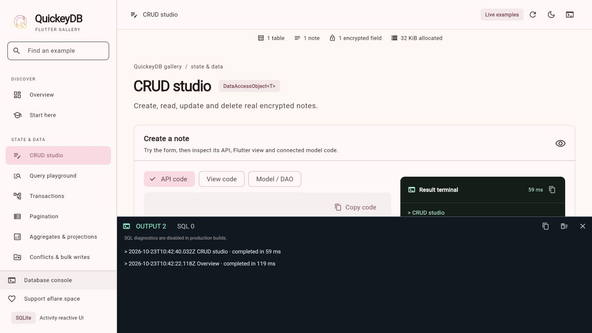
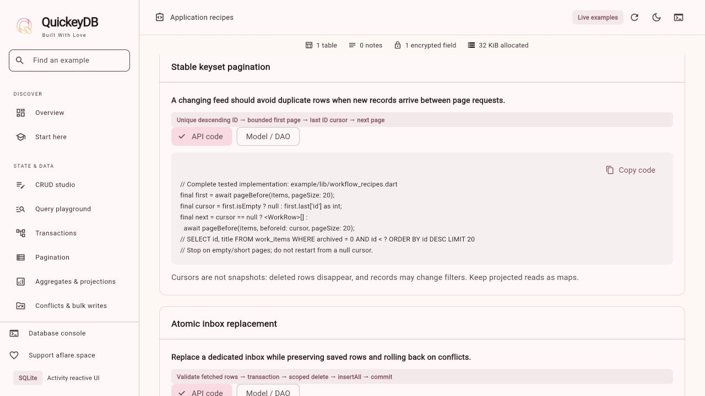

<p align="center"></p>

# QuickeyDB reactive gallery

**19 sections for learning, trying and adapting local data patterns.**



The gallery now follows the Activity example’s layout: grouped,
searchable sidebar navigation; a compact top bar; API badges; preview/source
cards; a green overview hero; light/dark/system themes and five accent colors.
It keeps the gallery organization inspired by the
[Fluent UI showcase](https://bdlukaa.github.io/fluent_ui/) while using Material widgets.
Search accepts section titles, descriptions and API names such as `sumNumber`.
On narrow screens, use the navigation drawer.

| Page | What you can try |
| --- | --- |
| Overview | Feature cards, learning path and a clear explanation of data effects |
| Start here | SQL tables, rows, keys, DAOs, converters and your first query |
| CRUD studio | Create encrypted notes, edit drafts and delete individual records |
| Query playground | Eight presets: full rows, exact/LIKE/NOT filters, newest three, counts and metadata/title projections |
| Pagination | Load bounded pages, change page size, inspect total/page/rows and add six sample notes |
| Aggregates & projections | Optional title filter, count/min/max/sumNumber/average, flat titles, distinct titles and grouped duplicate titles |
| Transactions | Insert an atomic pair and deliberately roll back with before/after counts |
| Conflicts & bulk writes | Compare abort/ignore/replace, then try filtered multi-row update/delete; all probe writes roll back |
| Encryption | Compare a decrypted DAO result with raw SQLite ciphertext |
| Memory | Save/read/delete an encrypted draft with optional 10-second TTL |
| SQL to DAO | Generate named DAO classes and registration from multi-table SQL |
| Relations | Complete Projects/Tasks DAOs, SQL foreign keys, HasOne/HasMany/BelongsTo, nested includes, SQL translations and join-table templates |
| Migrations & indexes | Validate version/index inputs, generate an additive upgrade plan and inspect the actual current query plan |
| Schema explorer | Live read-only table SQL and column explanations |
| Storage & lifecycle | Persistence, database ownership, migrations and recovery |
| API cookbook | Complete Note/NotesDao conversion plus query, bulk, relation and Memory recipes |
| Application recipes | Notes repository, draft autosave, offline outbox, catalog cache, search/filter and expiring preferences |
| Tips & points | A 12-item integration checklist and practical do/don’t guidance |
| Appearance | Light/dark/system themes and emerald/blue/violet/rose/amber accents |

## Understand what each example changes

Existing saved notes and keys are reused. CRUD, atomic sample pairs and the
**Add six paging notes** button write real notes to the same encrypted database.
Delete those samples individually in CRUD when finished. Pagination and aggregate
reads otherwise leave data unchanged. Conflict and bulk probes create temporary
rows inside a transaction and deliberately roll back; tests verify existing rows
and their decrypted contents are preserved.

Relation/application recipes are source examples, with required schemas and
application-provided services identified. They never open another database or
send network requests. Migration generation only returns source; the index query
uses read-only `EXPLAIN QUERY PLAN`. SQL-to-DAO generation never executes its SQL.
Memory writes to a separate key-value namespace.

## Use the preview, source and result panels

**Show source code** opens tabs for **API code**, **View code** and **Model / DAO**
when the example connects to a model. CRUD includes a complete Activity-backed
form, edit/delete list and Note/NotesDao definitions. Query source includes a
complete reactive query view. Other Note examples include a reusable reactive
list/result view pattern; relation and application contexts supply the matching
map-based DAO source. String-only Memory examples do not invent a SQL model.
Each selected source has its own copy button.

Runnable examples include a dark **Result terminal** with actual output, running
state, errors, elapsed time and **Copy terminal output**. Source mode places the
terminal next to code on wide panels and below it on smaller ones. The terminal
is a read-only view of application results, not an operating-system shell. CRUD
reports saved/deleted IDs and records; queries display their real JSON result.
Pagination, aggregates, transactions, encryption, Memory and probes use the same
result state. Code-only recipes never pretend to execute a backend.

For **Query playground → All notes**, choose ascending/descending order, ID/title
sorting, metadata projection, a limit and an offset, then run the query. Opening
its source shows both ordering directions plus page, projection, count, title and
filter alternatives, alongside the currently selected live query. Full-row
`toList()` reads use Note; partial-column reads use `toMap()`.



## Activity state and routes

The example uses the sibling Activity development checkout through
`activity: {path: ../../Activity}`. Keep `Activity/` beside `quickeydb/` when
running this checkout. The example now needs **Dart 3.9 / Flutter 3.35+**, matching QuickeyDB 3.0.0’s
minimum declared IDB dependency.

The app owns one **GalleryController** and **ActivityRouter**. Registered reactive
values hold notes, stats, per-section results, terminal runs, errors, preferences
and the operation log. Database work uses `activeAsync`; selectors rebuild
appearance/console consumers, and Activity supplies screen updates. Local text
controllers and form options remain screen state. Disposing the app releases its
router/controller while leaving the separately owned database handle explicit.

Sections have named, shareable hash URLs such as `/#/crud`, `/#/queries` and
`/#/pagination`. The gallery preserves form/query state while switching sections.
Click a saved note to open `/#/crud/notes/42`; the detail page reads the typed model
and returns a String result to the inline terminal. Invalid section names redirect
to Overview, and missing notes show an empty state. Browser route changes remain
available while operations finish; outputs stay attached to their original section.

The bounded live console records operation names/outcomes and elapsed time,
excluding note contents and encryption keys. Appearance and checklist state last
for this app session.

| File | Responsibility |
| --- | --- |
| `lib/main.dart` | Existing secure key startup and database initialization |
| `lib/showcase.dart` | Activity router, gallery shell, CRUD/query/transaction demos and reactive console |
| `lib/gallery_controller.dart` | Shared Activity controller, registered state, database reads/writes, async lifecycle and terminal results |
| `lib/view_samples.dart` | Complete CRUD/query view samples, reusable list/controller patterns and typed note detail route |
| `lib/gallery_widgets.dart` | Activity-style themes, panels, badges, preview/source cards and do/don’t pairs |
| `lib/advanced_pages.dart` | Pagination, aggregates, rolled-back probes, relation guide, migration plan and appearance |
| `lib/recipes.dart` | Detailed contextual source samples and the integration checklist |
| `lib/learning_pages.dart` | Beginner guide, Memory, SQL generation, schema and lifecycle pages |
| `lib/notes.dart` | Typed Note model and encrypted NotesDao; optional per-DAO conflict policy |

Run these commands from this folder (example/), rather than the package root:

```sh
flutter pub get
dart run tool/setup_web.dart
flutter run -d chrome --web-port 8080
```

The SQLite worker and matching WASM are checked in. Setup recompiles/downloads
those assets when backend dependencies change; it avoids the upstream worker
build-runner failure on the current SDK. Chrome uses SQLite/WASM backed by
IndexedDB. Use the same hostname and port on each run: changing origins creates
a different browser database and key store. Localhost/HTTPS is required for web
secure storage. The Flutter bootstrap serves local CanvasKit assets.

The example encrypts note bodies with AES-GCM. Titles and IDs remain plaintext
for normal queries. A separate private_notes database leaves older Task/User
demo databases unchanged. Native platforms use application-support/.quickeydb;
browser paths are virtual namespaces and do not hide data from developer tools.

A random key is generated once and saved with flutter_secure_storage. Native key
storage uses platform facilities; browser storage is origin-bound and cannot
protect against malicious scripts in the same origin. Missing key plus existing
database produces an error instead of replacing the key. Never clear browser
storage or regenerate a key as an attempt to recover existing encrypted data.

For native targets, follow the plugin's
[platform setup](https://pub.dev/packages/flutter_secure_storage/versions/9.2.4).
macOS Keychain Sharing entitlements and Android backup disabling are included.
Linux needs the documented libsecret/JSON packages; iOS/macOS need suitable signing
and Keychain capabilities. Run `flutter run -d macos` for an installed native target.

```sh
flutter analyze
flutter test
dart run tool/test_web.dart
```

The browser regression starts Chrome and checks worker startup, encrypted raw
values, persisted reopening, and wrong-key rejection. The helper temporarily
serves the checked-in SQLite assets through Flutter's test server. The widget and browser gallery tests cover CRUD, query results and rollback;
the browser tests also check narrow-screen navigation, pagination, aggregates,
conflict policies, bulk rollback and read-only migration generation. Neither replaces device
signing/secure-store integration checks.

If startup fails, the screen and debug console now include the actual error.
`Target file lib/main.dart not found` means you ran from the package root.
Missing sqflite_sw.js/sqlite3.wasm means setup assets are absent or stale. The
verbose Flutter VM-service method warnings in the pasted log are debugger
messages, separate from database initialization. Xcode is needed for Apple-native
builds, not Chrome.

See the [package README](../README.md) for encryption boundaries and migration.


If tests stop before loading with an `objective_c` SDK hook error, check
`xcrun --sdk macosx --show-sdk-path`. An unaccepted Xcode license prevents native
asset setup even when the test target is Chrome. Complete Xcode setup locally,
then rerun the tests. `flutter build web --debug --no-pub` validates the web build
separately.


## A first tour

1. **Start here:** understand tables, rows, keys and the DAO/Converter connection.
2. **CRUD studio:** create a note, edit its title/body, then query its title.
3. **Query playground:** compare row results, counts and flat title projections.
4. **Transactions:** add an atomic pair, then test rollback; counts stay equal on
   the rollback. Batch records persist until you delete them in CRUD.
5. **Encryption:** compare the same body through the DAO and raw SQLite.
6. **Memory:** save a draft, read it, reload the app and read it again. Enable TTL
   before saving to expire the draft after ten seconds. Reading checks expiry;
   the UI does not run a background countdown.
7. **SQL to DAO:** generate the bundled Projects/Tasks schema, copy the source
   into your app, then register the named classes. Try invalid input to see a
   descriptive error; invalid input clears the previous generated preview.
8. **Schema explorer**, **Tips & points** and **Storage & lifecycle:** connect
   the examples to application design and safe schema changes.

## What the top bar shows

| Stat | Meaning |
| --- | --- |
| Tables | Application tables from `sqlite_master`; internal/security tables excluded |
| Notes | Rows currently loaded from the notes DAO |
| Encrypted field | Configured encrypted columns in `NotesDao`, not a whole-file encryption indicator |
| Allocated KiB | SQLite `page_count × page_size`, including internal/free pages |

Counts refresh after note mutations and through the refresh icon. Allocated KiB
is a database page estimate, not browser quota usage or the combined size of
SQLite and Memory. The gallery intentionally loads a small notes dataset;
production lists should paginate rather than fetching every row for a count.

## SQL → ready DAO

This screen calls the package’s public `SqlDaoGenerator`, not an example-only
parser. It accepts multiple ordinary `CREATE TABLE` statements with one primary
key per table. It preserves SQL foreign keys and produces map converters and
named DAO subclasses. The output is source text: no files are written and no
SQL is executed. Add typed models, relations and encryption configuration
explicitly. Composite keys, indexes, triggers, views, data changes and table
options are unsupported. See the [package API guide](../README.md#generate-ready-daos-from-sql)
for registration, limits and a complete use example.

## Memory ownership

The Memory demo uses the separate `quickey_gallery_drafts_v1` namespace and only
the `draft` key. It shares the application’s persisted `ValueEncryption` key,
awaits writes, and closes its handle when the gallery is disposed. Its values
are not part of notes transactions or top-bar counts. Without an expiry they
persist across restarts; with TTL they disappear on an expired read. Deleting a
draft does not clear other keys. Tests use isolated namespaces.

## Tests by feature

| Folder | Coverage |
| --- | --- |
| `test/widget_test.dart` | Gallery overview, external-write stat refresh and theme switching |
| `test/gallery/` | All 19 sections, CRUD, source tabs, live terminals, ASC/DESC/projections, Activity routes/draft retention/typed results, database probes, migration safety, checklist and appearance |
| `test/browser/storage_test.dart` | Worker startup, ciphertext, reopen, key rejection |
| `test/browser/gallery_test.dart` | Browser CRUD/query/rollback and mobile drawer |
| `test/browser/advanced_gallery_test.dart` | Real worker pagination/aggregates, conflict/bulk rollback, migration safety, Activity routes and API/View/Model source tabs |
| `test/browser/learning_test.dart` | Live stats, beginner content, SQL generation without execution, Memory and schema |

The browser helper serves temporary worker/WASM fixtures and cleans them up.
The package’s [test map](../test/README.md) describes ORM, Memory, migration,
encryption and generator tests. Full device signing and secure-storage platform
integration remain separate from these tests.


## Adapt an application recipe

Each context explains when to use it, its data flow, the required schema and its
limitations. The Notes repository and model snippets use this example’s real
`Note`/`NotesDao`. Relationship code supplies complete map-based DAOs and a
standalone initialization sequence. Close the current owner before opening a
separate application database; QuickeyDB has one active instance.

Outbox/catalog recipes require the stated application tables and DAOs. The outbox
accepts an application-provided sender and marks an item sent only after that
sender succeeds; add server idempotency, retries and reconciliation for production.
The catalog replacement assumes a dedicated replaceable cache table. Draft
autosave demonstrates debouncing, serialized writes, error retention and cleanup;
flush the latest draft explicitly on submission. These samples explain the
persistence boundary rather than supplying an HTTP backend.

For migrations, align the final DAO schema and converters with the generated
callback before applying it. Install idempotent indexes after initialization for
fresh databases as well as upgraded ones. Test actual historical schemas and the
original encryption key; generating a plan in the gallery does not validate an
application’s complete upgrade history.

## Platform setup and console diagnostics

### Web: viewport and hot restart

Flutter owns the full-page viewport. `web/index.html` deliberately has no custom
`<meta name="viewport">`, so the engine no longer warns about replacing it.
`Starting application…` and `Hot restarting application… (generation: …)` are
normal development messages.

A `removeChild` exception from `main.dart.js` during `dart-app-ready` is a known
Flutter debug-loader bug, rather than a DAO exception. The upstream repair is
[Flutter PR #192233](https://github.com/flutter/flutter/pull/192233): remove the
loader safely and run its readiness listener once. An already-running Flutter
process keeps its original generated bootstrap. Stop it completely and restart
`flutter run` after repairing/updating the SDK; hot restart alone is insufficient.

For SDKs that still contain the exact affected code, this checkout includes a
narrow, idempotent backport helper:

```sh
# Read-only detection, from example/:
dart tool/repair_web_debug.dart --check
# Explicitly modifies the shared Flutter SDK, saves a backup, and invalidates
# its CLI snapshot. Other projects using that SDK will use the repair too:
dart tool/repair_web_debug.dart --apply
```

Use `--sdk=/absolute/path/to/flutter` if the helper cannot locate the SDK.
Prefer an official Flutter release containing the fix when available. The
helper does not patch app events or suppress errors. Its backup is stored next
to the SDK’s bootstrap.dart as `bootstrap.dart.quickeydb-backup`. Restore that
source and remove the SDK CLI snapshot/stamp to undo the local backport. Stop
Flutter processes before applying or reverting it.

A project-only alternative while using an affected SDK is:

```sh
flutter run -d web-server --web-port 8080
# Open the printed URL in Chrome. This avoids Flutter's Chrome debug loader;
# it does not provide the same integrated Chrome debugging workflow.
```

A separate Flutter engine assertion, “Trying to render a disposed
EngineFlutterView”, can still occur while hot restarting an active renderer
([upstream issue #182377](https://github.com/flutter/flutter/issues/182377)).
It also appeared in the headless debug restart check here. This SDK backport
fixes the loader exception only; it does not suppress engine assertions. Use a
full browser reload if that engine assertion appears, or hot reload for ordinary
UI edits.

### macOS/iOS: Xcode components and CocoaPods

`IDESimulatorFoundation`/`CoreSimulator.framework` missing, `xcdevice list`
failing, or SPM migration failing before compilation indicates incomplete Xcode
setup. Check the selected Xcode and complete first-launch components:

```sh
xcode-select -p
xcodebuild -runFirstLaunch
xcrun xcdevice list --timeout 5
xcrun --sdk macosx --show-sdk-path
flutter doctor -v
```

See Apple’s [component installation guide](https://developer.apple.com/documentation/xcode/downloading-and-installing-additional-xcode-components).
Open Xcode to complete any license or administrative prompts if required.
Disabling Swift Package Manager does not repair a missing system framework.

The pinned secure-storage macOS plugin still uses CocoaPods, even with SPM
integration enabled for other plugins. Install CocoaPods (`brew install
cocoapods` on a Homebrew Mac), verify `pod --version`, and rebuild. Native keychain
entitlements remain enabled. If Xcode reports that Runner’s entitlements require
a development certificate, open `macos/Runner.xcworkspace`, select Runner →
Signing & Capabilities, and select your development team with automatic signing.
You need a valid Apple development signing identity installed in your keychain;
`security find-identity -v -p codesigning` checks that. Preserve your existing
bundle identifier/team for an installed app whose keychain key you need to keep.
Removing keychain entitlements just to make the build pass breaks the secure-key
setup. An unsigned compile check is not a substitute for a signed runtime test. The example targets macOS 12+ and iOS 15+, aligned
with the current Flutter project tooling; these are example targets, not a new
package Dart SDK requirement. iOS device builds also require your signing team.

### Android: one Gradle configuration

The example uses Kotlin DSL only: `settings.gradle.kts`, `build.gradle.kts`, and
`app/build.gradle.kts`. Do not restore legacy `.gradle` files alongside them:
Gradle can select those files and run the removed imperative Flutter loader.
AGP 9.1 / Kotlin 2.4 use Gradle 9.3.1 here, matching the installed Flutter template.
The wrapper downloads the smaller `bin` distribution. Kotlin is explicitly
applied with the compatibility flags needed by existing Flutter plugins.

Flutter can use Android Studio’s bundled JDK; a separate system `java` command
is not required. Check `flutter doctor -v` for the actual Java executable. Install
the SDK/NDK versions requested by Flutter and accept their licenses through the
normal Android SDK setup. Android backup is disabled to avoid restoring encrypted
data without its matching secure-storage key.

### Linux and Windows

Linux needs the Flutter desktop compiler/GTK toolchain plus the secure-storage
plugin’s libsecret/jsoncpp development libraries. Its secret service/keyring must
be available and unlocked; a headless session may have no keyring service.
Windows needs Flutter’s supported Visual Studio C++ desktop toolchain and Windows
SDK. Build and secure-storage integration checks for these platforms must run on
their respective hosts; a macOS build cannot validate them.

### Run checks without sharing build artifacts concurrently

Run Flutter builds and example tests sequentially in the same checkout. Native
asset staging under `example/build/` is shared: simultaneous platform builds can
remove or replace files another build/test is using.

```sh
flutter test
dart tool/test_web.dart
# A focused browser regression:
dart tool/test_web.dart test/browser/learning_test.dart
flutter build web --debug --no-pub
flutter build macos --debug --no-pub
flutter build apk --debug --no-pub
flutter build ios --simulator --debug --no-pub
```

Browser fixtures use root-relative URLs so feature subfolders resolve the same
worker and WASM. UI tests drain real database futures before interacting; fixed
short sleeps and `pumpAndSettle` alone do not reliably complete host database I/O.


If an iOS simulator build reports “No Xcode build settings have been found”, rerun
with `-v` to reveal the underlying Xcode error. The build SDK and simulator
runtime are separate components: `xcodebuild -showsdks` lists build SDKs, while
`xcrun simctl list runtimes` lists installed simulator runtimes. Use an existing
available simulator when present. With only the build SDK installed, use
`flutter build ios --debug --no-codesign --no-pub` for a device compilation check;
this does not install a runtime or validate signing or simulator execution.
The project uses Flutter’s UIScene lifecycle and registers
plugins through `didInitializeImplicitFlutterEngine`; the scene manifest selects
the framework-provided `FlutterSceneDelegate`.

Startup failures now show instructions for the actual target platform instead of
always suggesting web setup. They retain the real error and advise restoring an
existing key rather than replacing it or clearing data.

## Console, support and release setup



Built reactively by [Activity](https://pub.dev/packages/activity). Open **Database
console** from the top bar or navigation drawer for a bottom dock with Output and
SQL tabs. In debug builds, enable **Raw SQL templates**, then run an example.
DAO SQL, duration, row/parameter counts and safe failures appear there; data values
and keys do not. Production builds disable SQL diagnostics. Direct raw SQL used
by schema/encryption demos is not intercepted.

The footer promotes [aflare.space](https://aflare.space), links the
[GitHub community](https://github.com/itskenzylimon/quickeydb), and offers gift,
coffee and social slots. Set `GIFT_URL`, `COFFEE_URL`, `SOCIAL_URL` using
`--dart-define`; defaults are empty and buttons stay disabled. Example values:
`https://example.com/your-gift-page`, `https://example.com/your-coffee-page`,
`https://example.com/your-social-profile`. Replace before deployment.

Read the [full relation templates](../doc/RELATIONS.md),
[3.0.0 migration guide](../doc/MIGRATING_TO_3.md), and
[release gates](../doc/RELEASING.md). The current local Activity path is deliberate:
pub.dev Activity 1.5.3+5 lacks the new state/router APIs. Publish the companion
Activity update first, then replace that path with the verified public constraint
and rerun this example's checks from an isolated checkout.

## Brand palette

The supplied Q logo sets the default pink seed (#EC2182), with orange (#F38141)
and yellow (#F8C612) accent options. Light and dark Material themes use matching
warm surfaces. The [standalone package example](example.md) runs without the
sibling Activity checkout; this full gallery uses Activity for state and routes.

## In-depth workflows

The [feature cookbook](../doc/FEATURE_RECIPES.md) explains query ownership,
keyset pagination under concurrent inserts, projections, atomic inbox replacement,
scoped deletion, index/migration planning, key recovery, Memory shutdown and safe
diagnostics. The Application contexts page includes two additional source recipes.
Copy [workflow_recipes.dart](lib/workflow_recipes.dart) and register WorkItems once;
[real SQLite contracts](../test/documentation/workflow_recipes_test.dart) verify
paging, rollback, unrelated-row preservation and query isolation.


